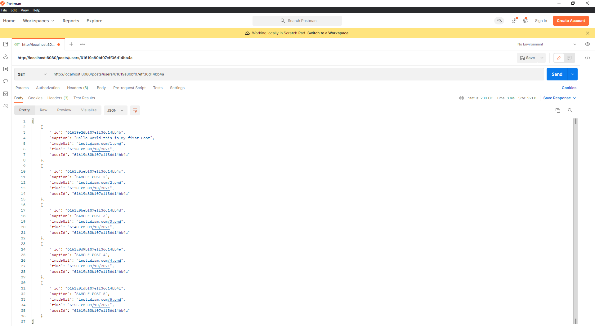

# Instagram-Style REST API in Go

A small REST API in Go that copies a few parts of Instagram's backend: creating and fetching users, creating and fetching posts, and listing a user's posts page by page. It uses only the standard `net/http` package and stores data in MongoDB.



## Why it is interesting

- Routing is done by hand with `http.ServeMux` and by splitting the URL path, with no web framework.
- Listing a user's posts is paginated with MongoDB `limit` and `skip`, five posts per page, with an optional page number in the path.
- Passwords are stored as a base64-encoded MD5 hash rather than in plain text. Unsalted MD5 is not a safe way to store passwords; a real service would use bcrypt or Argon2.
- Every handler takes one global mutex, so requests are processed one at a time. The error paths return without releasing it, so a single bad request leaves the server stuck.

Endpoints (server on `localhost:8080`):

```
POST /users                         {"name": "...", "email": "...", "password": "..."}
GET  /users/<userId>
POST /posts                         {"caption": "...", "imageUrl": "...", "time": "...", "userId": "..."}
GET  /posts/<postId>
GET  /posts/users/<userId>[/<page>] five posts per page, page 1 by default
```

## Run it

Needs MongoDB running on `localhost:27017`; the API uses a database called `appointy`.

The code was written in 2021 for Go's pre-modules GOPATH mode: there is no `go.mod` and `main.go` imports `./restAPI` by relative path. Current Go rejects that in module mode, so it needs an older toolchain (Go 1.21 or earlier) in GOPATH mode. These are the 2021-era steps and have not been re-run since; `go get` may now fetch a newer driver layout than the code expects:

```bash
export GO111MODULE=off
go get go.mongodb.org/mongo-driver/mongo
go run main.go
```

## Tech

Go, net/http, MongoDB Go driver.

## Context

Submission for the Appointy technical task (internship round), October 2021.

## License

MIT, see LICENSE.
